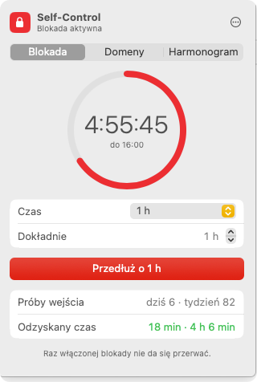

# Self-Control

<p align="center"></p>

Blokada rozpraszających stron na macOS. Działa ręcznie (na określony czas), według harmonogramu (dni + godziny, także przez północ) albo w trybie pomodoro.

Raz włączonej blokady nie da się obejść z poziomu aplikacji: można ją tylko zaostrzyć (dodać domeny, przedłużyć). Usunięcie domeny, skrócenie czasu czy wyłączenie aktywnego harmonogramu wchodzi w życie dopiero po końcu blokady.

## Wymagania

- macOS 15 lub nowszy
- Xcode Command Line Tools (`xcode-select --install`), Swift 6
- konto z uprawnieniami administratora (sudo)

## Instalacja

```sh
git clone https://github.com/sz4rlej/self-control.git
cd self-control
scripts/install.sh
```

Skrypt:

1. buduje projekt (`swift build -c release`),
2. instaluje demona `selfcontrold` jako usługę systemową (launchd, root),
3. dodaje lokalny certyfikat strony blokady do zaufanych w pęku kluczy systemowym,
4. instaluje aplikację do `/Applications/Self-Control.app` i ją uruchamia.

Po instalacji w pasku menu pojawia się kłódka. Aktualizacja to po prostu ponowne `scripts/install.sh`.

## Używanie

Kliknij kłódkę w pasku menu:

- **Start blokady** — wybierz czas (np. 60 min) albo tryb pomodoro (25/5, 45/15, 50/10). Po pracy przychodzi przerwa, a na jej koniec pytanie o kolejną sesję.
- **Domeny** — lista blokowanych stron. Wpisz adres albo dodaj gotową listę jednym kliknięciem (social, wideo, newsy, sport, humor, zakupy). Blokowana jest domena wraz z `www.`, `m.` i `mobile.`.
- **Harmonogramy** — np. Pn–Pt 8:30–16:00. Blokada włącza się sama.

Wejście na zablokowaną stronę pokazuje stronę blokady z liczbą prób i odzyskanym czasem (statystyki, ranking domen, rozkład godzinowy).

## Jak to działa

- `selfcontrold` — demon uruchamiany jako root. Co 5 s czyta konfigurację z aplikacji, łączy ją z obowiązującą i przepisuje sekcję self-control w `/etc/hosts`. Ręczna edycja tego pliku nic nie da, bo zostanie nadpisana.
- Zablokowane domeny wskazują na `127.94.0.1` / `fd5c:5c5c::1` (aliasy na `lo0`), gdzie demon serwuje stronę blokady po HTTP i HTTPS.
- Na czas blokady wyłączany jest iCloud Private Relay (`mask.icloud.com`), bo Safari z włączonym przekaźnikiem omija `/etc/hosts`. Pozostałe strony działają normalnie.
- `SelfControlApp` — aplikacja w pasku menu. Zapisuje żądaną konfigurację i pokazuje stan demona.

Pliki:

| Co | Gdzie |
|---|---|
| żądanie od aplikacji | `/Users/Shared/SelfControl/request.json` |
| stan demona | `/Library/Application Support/SelfControl/state.json` |
| log | `/var/log/selfcontrold.log` |

## Odinstalowanie

```sh
scripts/uninstall.sh
```

Działa tylko poza blokadą. Usuwa demona, aplikację, certyfikat i aliasy sieciowe.

## Rozwój

```sh
swift build
swift test
```

## Ograniczenia

- Blokada działa na poziomie DNS (`/etc/hosts`), więc obejdzie ją VPN, własny DNS-over-HTTPS w przeglądarce albo wpisanie adresu IP.
- Blokowane są tylko podane subdomeny (`www.`, `m.`, `mobile.`), a nie wszystkie (`*.domena`).
